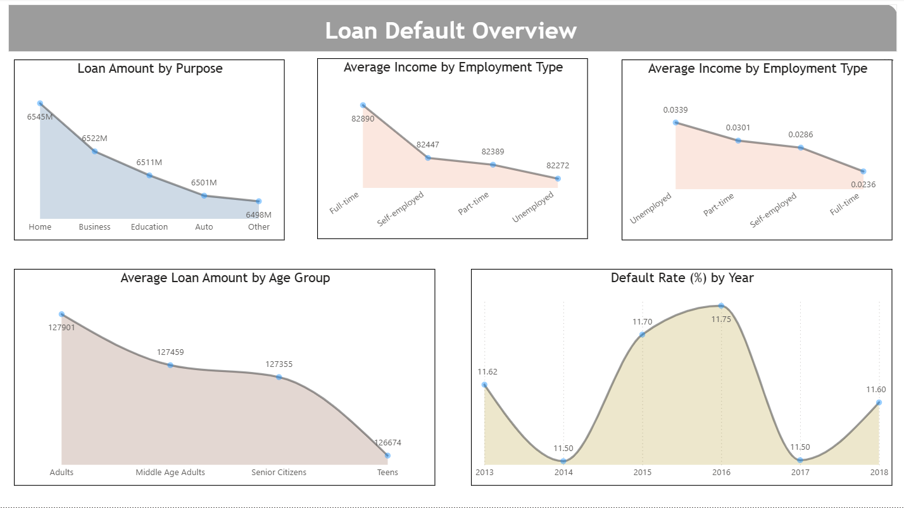
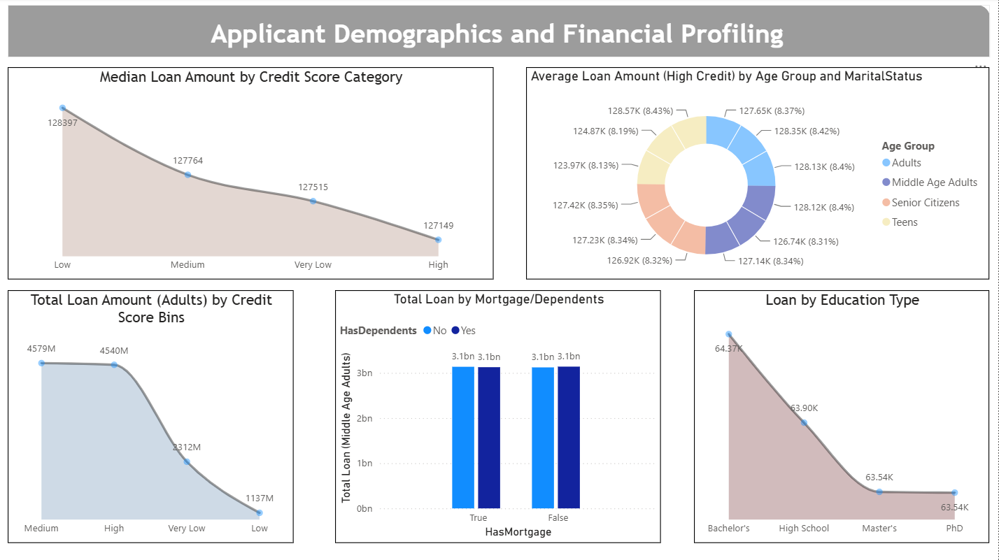
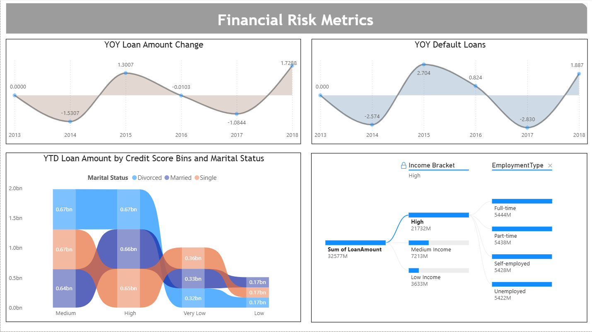

# Loan Default Risk Analysis | Power BI

> **Power BI analysis of 255K+ loan records to identify borrower, financial, employment, and loan characteristics associated with default risk.**

## Dashboard Preview

### Loan Default Overview



### Applicant Demographics & Financial Profile



### Financial Risk Metrics



---

## Project Overview

This project analyzes **255,347 loan records** to identify patterns and characteristics associated with loan default risk.

The analysis examines borrower demographics, financial characteristics, employment information, credit profiles, and loan attributes to understand how these factors differ between borrowers who defaulted and those who did not.

The project was developed using **Microsoft Power BI** to transform a large loan dataset into an interactive business intelligence report.

---

## Business Problem

Financial institutions need to understand the characteristics associated with loan defaults in order to better evaluate portfolio risk and identify borrower segments that may require additional attention.

This analysis focuses on questions such as:

- What is the overall loan default rate?
- How does default rate vary across employment types?
- How do income, loan amount, and interest rate differ between defaulting and non-defaulting borrowers?
- How does credit score relate to loan characteristics?
- How have loan amounts and defaults changed over time?
- Which borrower and loan characteristics are associated with higher observed default rates?

> **Important:** The analysis identifies statistical patterns and associations in the dataset. It does not establish causal relationships or represent a production credit-scoring model.

---

## Objectives

The primary objectives of the analysis were to:

1. Measure the overall loan default rate.
2. Compare financial characteristics of defaulting and non-defaulting borrowers.
3. Analyze default patterns across employment categories.
4. Segment borrowers using credit-score categories.
5. Examine loan characteristics across demographic groups.
6. Analyze changes in loan amounts and defaults over time.
7. Build an interactive Power BI dashboard for business-oriented risk analysis.

---

## Dataset

The dataset contains:

- **255,347 loan records**
- **20 variables**
- Loan data covering **2013–2018**

### Key Data Categories

| Category | Examples |
|---|---|
| Borrower Demographics | Age, Education, Marital Status, Dependents |
| Financial Profile | Income, Loan Amount, Interest Rate, DTI Ratio |
| Credit Profile | Credit Score, Number of Credit Lines |
| Employment | Employment Type, Months Employed |
| Loan Characteristics | Loan Purpose, Loan Term, Loan Date |
| Household Factors | Mortgage, Co-signer |
| Outcome | Default |

---

## Key Findings

### Overall Default Rate

The dataset has an overall observed loan default rate of approximately **11.6%**.

### Default Rate by Employment Type

Observed default rates vary across employment categories:

| Employment Type | Default Rate |
|---|---:|
| Unemployed | ~13.55% |
| Part-time | ~11.97% |
| Self-employed | ~11.46% |
| Full-time | ~9.46% |

The analysis shows an association between employment category and observed default rate, with unemployed borrowers having the highest rate among the categories analyzed.

### Financial Differences

Compared with non-defaulting borrowers, defaulting borrowers in this dataset have approximately:

- **Lower average income:** ~$71.8K vs. ~$83.9K
- **Higher average loan amount:** ~$144.5K vs. ~$125.4K
- **Higher average interest rate:** ~15.9% vs. ~13.2%
- **Lower average credit scores**
- **Slightly higher average DTI ratios**

These are descriptive differences within the dataset and should not be interpreted as evidence that any individual factor directly causes default.

---

## Power BI Dashboard

The report contains three analytical pages.

### 1. Loan Default Overview

Provides a high-level view of:

- Loan amount by purpose
- Average income by employment type
- Average loan amount by age group
- Default rate by year
- Default rate by employment type

### 2. Applicant Demographics & Financial Profile

Examines:

- Credit-score segmentation
- Median loan amount by credit-score category
- Loan amounts across credit-score ranges
- Mortgage and dependent characteristics
- Loan amount by education
- Borrower demographic patterns

### 3. Financial Risk Metrics

Provides deeper financial analysis including:

- Year-over-year loan amount change
- Year-over-year default loans
- Loan amount by credit-score category and marital status
- Decomposition tree analysis for exploring risk-related segments

---

## Business Recommendations

Based on the observed patterns in the dataset, financial institutions could consider:

1. **Segmenting borrowers by risk characteristics** rather than evaluating the portfolio only at an aggregate level.
2. **Monitoring higher-risk employment segments** where observed default rates are elevated.
3. **Evaluating loan amount relative to borrower financial capacity**, particularly where larger loans coincide with weaker financial profiles.
4. **Incorporating credit and affordability indicators together** when analyzing portfolio risk.
5. **Using interactive reporting to identify changing risk patterns over time** and across borrower segments.

These recommendations are analytical considerations based on the dataset and are **not intended as actual lending or credit-policy recommendations**.

---

## Tools & Skills Demonstrated

- **Microsoft Power BI**
- Data cleaning and preparation
- Exploratory data analysis
- Data visualization
- KPI development
- Interactive dashboard design
- Financial and risk analysis
- Segmentation analysis
- Trend analysis
- Business insight generation

---

## Project Structure

```text
loan-default-risk-analysis-dashboard/
│
├── data/
│   └── Loan_default.csv
│
├── powerbi/
│   └── Loan_Default_Risk_Analysis.pbix
│
├── screenshots/
│   ├── loan-default-overview.png
│   ├── applicant-demographics.png
│   └── financial-risk-metrics.png
│
├── .gitignore
└── README.md
```

---

## Data Dictionary

| Column | Description |
|---|---|
| Age | Borrower's age |
| Income | Borrower's income |
| LoanAmount | Amount of the loan |
| CreditScore | Borrower's credit score |
| MonthsEmployed | Length of employment |
| NumCreditLines | Number of credit lines |
| InterestRate | Loan interest rate |
| LoanTerm | Loan repayment term |
| DTI Ratio | Debt-to-income ratio |
| Education | Borrower's education level |
| EmploymentType | Employment category |
| MaritalStatus | Borrower's marital status |
| HasMortgage | Whether the borrower has a mortgage |
| HasDependents | Whether the borrower has dependents |
| LoanPurpose | Purpose of the loan |
| HasCoSigner | Whether the loan has a co-signer |
| LoanDate | Date of the loan |
| Default | Loan default outcome |

---

## Key Takeaway

The analysis demonstrates how a large loan portfolio can be transformed into an interactive risk-analysis dashboard to uncover differences across borrower demographics, employment categories, financial profiles, credit characteristics, and loan attributes.

The project emphasizes **descriptive and exploratory risk analysis**, using Power BI to make large-scale financial data easier to interpret and communicate.

---

## Disclaimer

This project is created for **educational and portfolio purposes**.

The findings represent patterns observed in the provided dataset and should not be interpreted as financial advice, lending policy, credit approval criteria, or a production credit-risk model.